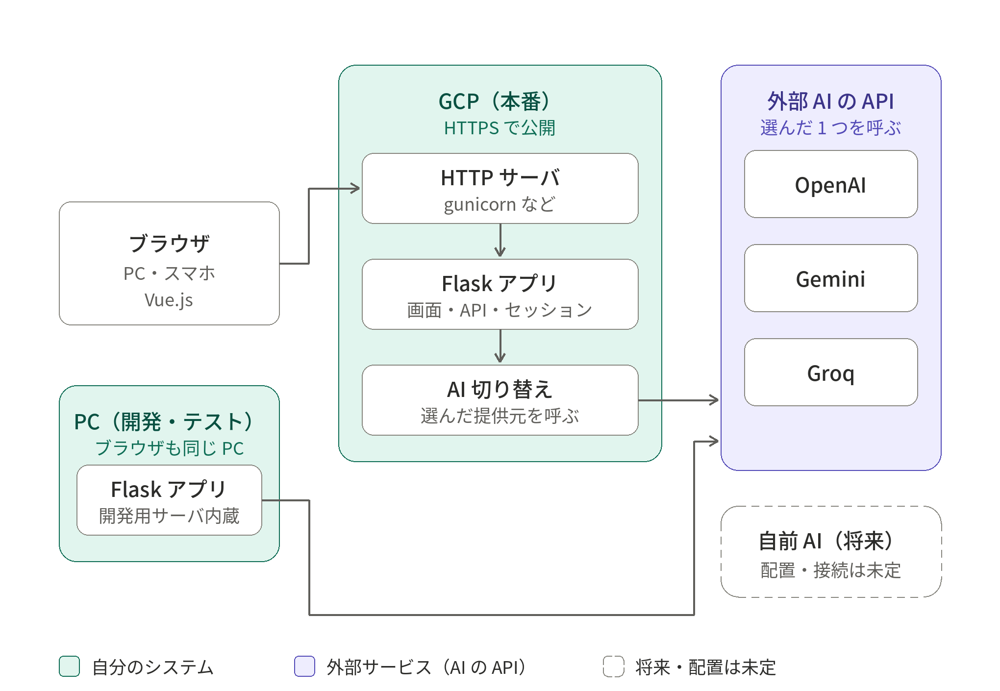
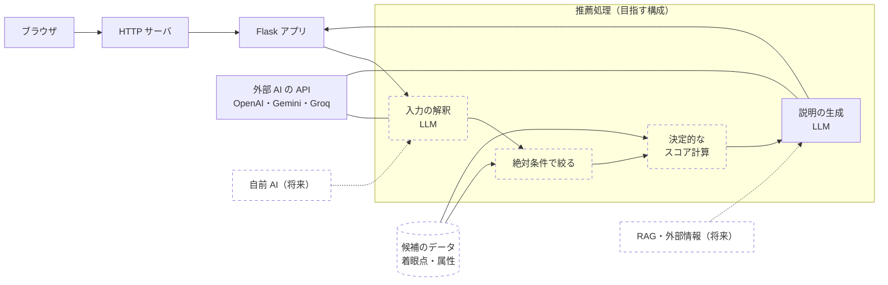

# 2 システム構成

## 2.1 全体像（画面と処理の流れ）

利用者がブラウザで質問に答えると、サーバー側で AI が処理して、提案を返す流れを示した図です。
**図の内容と、現行版との対応**は、次のとおりです。

| 図の内容 | 現行版の状態 |
|---|---|
| 質問の表示 → 回答の入力 → 提案の表示 | 実装済み |
| AI サービス（OpenAI・Gemini・Groq） | 実装済み。**1 回の処理で使うのは、利用者が選んだ 1 つ** |
| 複数の AI による検討・比較 | 利用者が選んだ AI で処理する。**複数を同時に呼んで比べる処理は未実装**（提供元どうしの比較は、[回帰テスト](05-quality.md)で行う） |
| ローカル LLM（Ollama など） | 接続口のみ（現状はダミー応答） |
| 一般的な旅行情報（インターネット公開情報） | 現行版は、**外部の情報を取得せず、AI の知識で答える**。参考リンクは、候補名から、検索へのリンクを画面側で作っている |
| AI の学習データ（各 AI の知識） | 図のとおり |
| 今後の拡張（構想） | 構想（独自データの追加、評価指標の導入など）。[9 章](09-roadmap.md)を参照 |

## 2.2 構成要素と環境

### 構成要素

| 要素 | 役割 | 備考 |
|---|---|---|
| ブラウザ | 質問の表示、回答の入力、提案の表示 | PC・スマートフォン。画面は Vue.js |
| HTTP サーバ | 利用者からの HTTPS の接続を受け、Flask アプリに渡す | 本番のみ。Flask とは**別の部品**で、WSGI という決まりで Flask と通信する |
| Flask アプリ | 画面の配信、API、セッションの検証、利用制限、プロンプトの組み立て | 開発では、Flask に内蔵の開発用サーバで動かす |
| AI 切り替え | 許可リストにある提供元だけを呼ぶ | 提供元ごとの違いは、ここに閉じ込める（[4 章](04-ai-integration.md)） |
| 外部 AI の API | OpenAI、Gemini、Groq | 1 回の処理で使うのは、選んだ 1 つ |
| 自前 AI | 将来の構想 | 配置と接続は未定。現状は、ダミー応答を返す枠のみ |

### 環境

| 観点 | PC（開発・テスト） | GCP（本番） |
|---|---|---|
| 役割 | 動作確認、自動テストの実行 | 公開 |
| 利用者 | 開発者のみ | 利用者（ブラウザから HTTPS で接続） |
| HTTP サーバ | Flask 内蔵の開発用サーバ | Flask とは別の HTTP サーバ |
| アプリ | 同じ Flask アプリ | 同じ Flask アプリ |

開発と本番で、**アプリは同じもの**です。違うのは、HTTP サーバと、公開の範囲だけです。

## 2.3 現行の構成と目指す構成

### 2.3.1 現行の構成

図の元データ：[SVG 版](img/system-configuration.svg)

- 左は、利用者の**ブラウザ**と、**開発・テスト用の PC**です。開発の PC では、ブラウザも同じ PC で動かします。
- 中央が**本番（GCP）**です。ブラウザからの接続は、HTTP サーバが受け、Flask アプリに渡します。Flask アプリは、AI 切り替えを通じて、選ばれた提供元を呼びます。
- 右が**外部の AI の API**です。本番の AI 切り替えと、開発の PC の Flask アプリのどちらからも呼びます。
- 右下の**自前 AI**は、将来の構想です。**PC にも GCP にも属さず**、配置も接続も決まっていません。

### 2.3.2 目指す構成

現行版は、候補もスコアも説明も、AI が作ります。目指す構成は、**順位の決定をデータと決定的な計算に任せ、AI は入力の解釈と説明に限る**ものです（考え方は[9 章](09-roadmap.md)、方式の検証は[参考実装](../reference/qar_ref/scoring.py)）。

破線は、現行版では未実装のものです。

| 項目 | 現行 | 目指す構成 |
|---|---|---|
| 候補 | AI が生成する | データに持つ候補から選ぶ |
| 絶対条件（日程・予算など） | AI の解釈しだい | 決定的な処理で、先に候補を除外する |
| 順位・スコア | AI が出す | 決定的な計算で出す（内訳つき） |
| AI の役割 | 質問・候補・スコア・説明のすべて | 入力の解釈と、説明の生成に限る |
| 最新情報 | AI の知識のみ | RAG・外部情報（将来） |
| 自前 AI | 枠のみ | 将来の検討。配置は未定 |

---

**章一覧**（[目次](index.md)）

- [1 概要](01-overview.md)
- **2 システム構成**（この章）
- [3 機能と画面遷移](03-features.md)
- [4 AI 連携設計](04-ai-integration.md)
- [5 品質保証](05-quality.md)
- [6 運用](06-operations.md)
- [7 セキュリティ方針](07-security.md)
- [8 2002 年版との比較](08-2002-vs-now.md)
- [9 今後の方針](09-roadmap.md)
- [10 技術スタックと役割](10-tech-stack.md)

← [1 概要](01-overview.md) ｜ [3 機能と画面遷移](03-features.md) →
