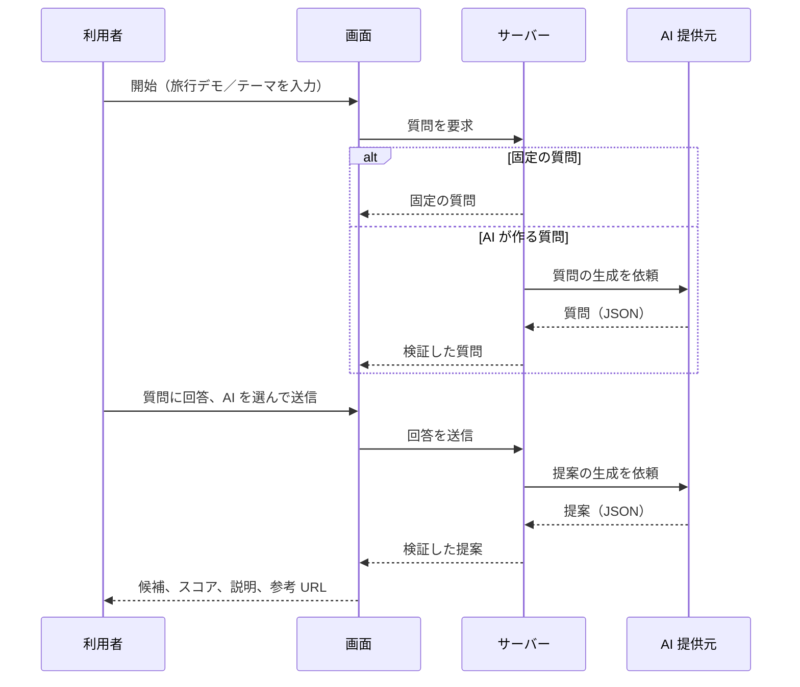

# 3 機能と画面遷移

## 3.1 画面

| 画面 | 内容 |
|---|---|
| 旅行先デモ | 「質問開始」で、**固定の質問**が表示される。回答後、**使いたい AI を選んで送信**すると、提案が表示される |
| テーマ指定の画面 | 利用者が、**テーマ**、**質問の作成指示**、**提案作成時の指示**、**回答者へのアドバイス**を入力する。AI を選んで質問を作らせ、回答後に提案を受ける |
| 2002 年版の資料 | 2002 年に作った設計資料（[アーカイブ](../archive/2002/index.html)） |

## 3.2 質問の種類

| 種類 | 入力 |
|---|---|
| 単一選択 | 選択肢から 1 つ |
| 複数選択 | 選択肢から複数 |
| 文字入力（1 行） | 出発地などの短い入力 |
| 文字入力（複数行） | 自由記述 |

## 3.3 提案の内容

提案は、複数の**候補**で構成されます。各候補は次の項目を持ちます。

| 項目 | 内容 |
|---|---|
| 候補名 | 提案する名称 |
| スコア | 0〜100 の、おすすめ度（現行版では AI が出す） |
| 説明 | 候補の説明と、おすすめの理由 |
| 参考 URL | 参考にできるページ（検索へのリンクも付く） |

結果が**参考情報である旨の注意書き**を、画面に表示します。

## 3.4 操作の流れ

## 3.5 汎用性

画面の入力（テーマと各種の指示）を変えるだけで、旅行以外のテーマでも、質問と提案を作れます。
旅行は、最初の題材です。

---

**章一覧**（[目次](index.md)）

- [1 概要](01-overview.md)
- [2 システム構成](02-architecture.md)
- **3 機能と画面遷移**（この章）
- [4 AI 連携設計](04-ai-integration.md)
- [5 品質保証](05-quality.md)
- [6 運用](06-operations.md)
- [7 セキュリティ方針](07-security.md)
- [8 2002 年版との比較](08-2002-vs-now.md)
- [9 今後の方針](09-roadmap.md)
- [10 技術スタックと役割](10-tech-stack.md)

← [2 システム構成](02-architecture.md) ｜ [4 AI 連携設計](04-ai-integration.md) →
