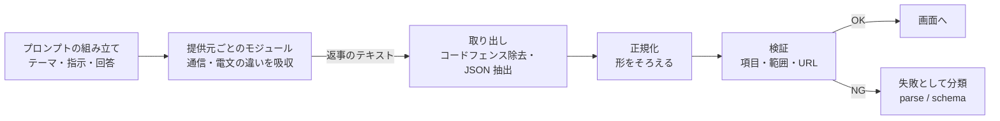

# 4 AI 連携設計

## 4.1 基本方針

1. **AI は「部品」として扱う。** 提供元ごとの違いは、提供元のモジュールの中に閉じ込める。
2. **AI の返事は、そのまま信用しない。** 取り出し → 正規化 → 検証を、共通の層で行ってから使う。
3. **使える提供元は、登録済みのものだけ**（許可リスト）。利用者の入力から、呼び出すモジュールを決めない。
4. **変わることを前提に、変化に気づける仕組みを持つ。** 実際の AI を使った回帰テストで、成功率を測る（[5 章](05-quality.md)）。

## 4.2 構成

この構成を、小さく書き下ろしたものが[参考実装](../reference/qar_ref/)です
（`providers.py`、`schema.py`、`service.py`）。

## 4.3 提供元ごとの違いと、その吸収

提供元によって、結果の取り出し方も、返事の揺れ方も違います。

| 提供元 | 返事の形 | 吸収している点 |
|---|---|---|
| OpenAI | 関数呼び出し形式。引数の JSON を取り出す | 引数文字列の JSON 解析 |
| Gemini | テキストの応答に JSON が含まれる | コードフェンスの除去、JSON の抽出 |
| Groq | ツール呼び出し形式、または通常のテキスト | 配列／オブジェクト／JSON の連続、といった複数の形に対応 |

**質問の返事は、次のような揺れを吸収しています。**
`{"questions": [...]}` の形、配列だけの形、質問のオブジェクトが連続する形。

## 4.4 失敗の扱い

失敗は、原因別に分類します（参考実装では `parse` と `schema`）。

| 分類 | 内容 |
|---|---|
| parse | JSON として解釈できない |
| schema | JSON だが、必要な項目が足りない、値が範囲外、種類が不正、など |

分類しておくと、回帰テストの集計で、「どの提供元が、どう崩れているか」が分かります。
失敗時のやり直し回数は、設定で変えられる設計です（[参考実装](../reference/qar_ref/service.py)）。

## 4.5 プロンプトの設計

- **形式を固定して頼む**：返事は JSON のみ、前置きや解説は付けない、と明示する。
- **結果の項目を定義する**：候補名、スコア（0〜100）、説明（字数の目安）、参考 URL。
- **質問の種類を限定する**：単一選択、複数選択、文字入力（1 行／複数行）。
- **利用者の入力は、プロンプトの「データ」として扱う**：AI への指示と、利用者の入力を区別して組み立てる。
- **未回答の項目への配慮**：回答がない部分も、その点についてアドバイスするよう頼む。

## 4.6 今後の強化

- 各社の**構造化出力**（スキーマを指定して、形式を保証する機能）への移行
- 提供元の戻り値の型を揃える、共通の入口の整備
- AI が返すリンクなどの、出力の検証の強化

詳細は[9 章](09-roadmap.md)を参照してください。

---

**章一覧**（[目次](index.md)）

- [1 概要](01-overview.md)
- [2 システム構成](02-architecture.md)
- [3 機能と画面遷移](03-features.md)
- **4 AI 連携設計**（この章）
- [5 品質保証](05-quality.md)
- [6 運用](06-operations.md)
- [7 セキュリティ方針](07-security.md)
- [8 2002 年版との比較](08-2002-vs-now.md)
- [9 今後の方針](09-roadmap.md)
- [10 技術スタックと役割](10-tech-stack.md)

← [3 機能と画面遷移](03-features.md) ｜ [5 品質保証](05-quality.md) →
