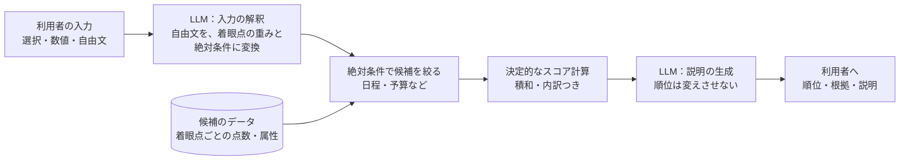

# 9 今後の方針

## 9.1 目指す方式：決定的な計算と LLM の組み合わせ

AI だけに順位を決めさせると、**再現性と根拠が弱く、一般の AI の利用と差別化できません。**
そこで、**順位の決定は、データと決定的な計算が受け持ち、AI は、その前後に限る**構成を目指します。

| 役割 | 担当 | 理由 |
|---|---|---|
| 自由な入力を、構造に直す | LLM | 自然な文章の理解が得意 |
| 絶対条件で絞る | 決定的な処理 | 条件を満たさない候補を、確実に除外する |
| 順位を決める | 決定的な処理 | 再現性があり、内訳で説明できる |
| 理由の文章を作る | LLM | 読みやすい説明を作れる |

**この方式の核（積和スコア、絶対条件、説明用プロンプト）は、[参考実装](../reference/qar_ref/scoring.py)で動かして確かめています。**
LLM に順位を変えさせない説明用プロンプトも、含めています。

## 9.2 段階

| 段階 | 内容 |
|---|---|
| 短期 | 提供元の戻り値の型を揃える／各社の構造化出力への移行／出力の検証の強化／回帰テストの定期実行と、成功率の推移の記録 |
| 中期 | 旅行先データの整備（着眼点ごとの点数、属性）／決定的なスコア計算の本体への導入／評価指標の整備 |
| 長期 | RAG による最新情報の参照／外部情報（運賃・天候など）／自前の LLM の接続 |

## 9.3 評価の観点

- **安定性**：提供元ごとの、使える返事の割合と、失敗の内訳の推移
- **再現性**：同じ入力に対する、順位の一致率
- **納得感**：順位の根拠を、利用者が理解できるか

---

**章一覧**（[目次](index.md)）

- [1 概要](01-overview.md)
- [2 システム構成](02-architecture.md)
- [3 機能と画面遷移](03-features.md)
- [4 AI 連携設計](04-ai-integration.md)
- [5 品質保証](05-quality.md)
- [6 運用](06-operations.md)
- [7 セキュリティ方針](07-security.md)
- [8 2002 年版との比較](08-2002-vs-now.md)
- **9 今後の方針**（この章）
- [10 技術スタックと役割](10-tech-stack.md)

← [8 2002 年版との比較](08-2002-vs-now.md) ｜ [10 技術スタックと役割](10-tech-stack.md) →
